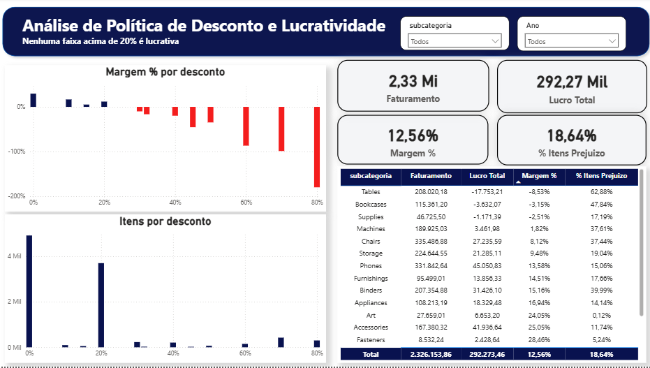
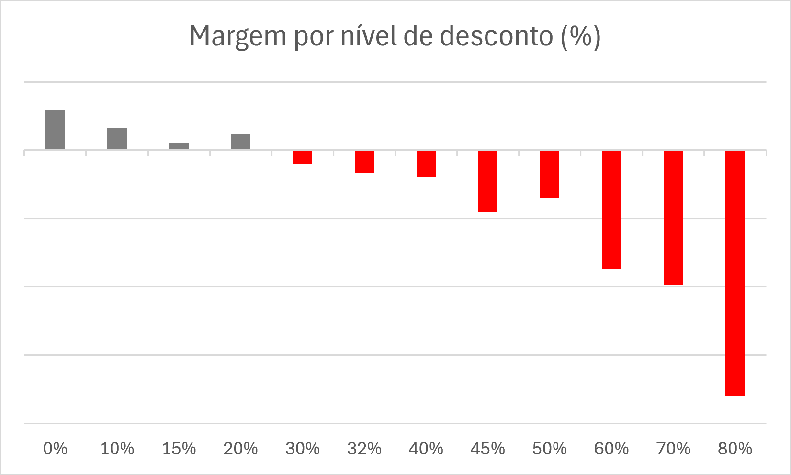
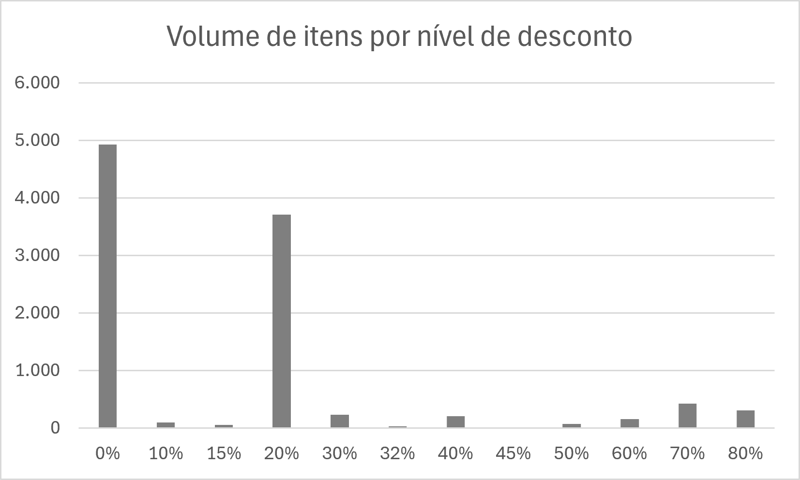

# Política de desconto e lucratividade

**A partir de qual desconto a venda deixa de compensar — e quanto custa não respeitar esse limite?**

Análise em SQL sobre 10.192 itens vendidos entre 2023 e 2026, com dashboard interativo em Power BI,
identificando o ponto em que o desconto passa a destruir margem e dimensionando o impacto disso.



---

## Contexto

Uma rede varejista de material de escritório e mobiliário fecha o período com 12,56% de margem sobre
2,33 milhões em faturamento. O número parece saudável, mas **18,6% dos itens vendidos dão prejuízo**.
Quase um em cada cinco.

Descontos são a explicação mais provável, mas "dar menos desconto" não é recomendação — é palpite. A
pergunta útil é onde exatamente está o limite, quanto se perde por ultrapassá-lo, e em quais produtos
isso se concentra.

---

## Dados

| | |
|---|---|
| **Origem** | Sample Superstore (Kaggle) |
| **Volume** | 10.194 linhas brutas → 10.192 após tratamento |
| **Granularidade** | 1 linha = 1 item dentro de um pedido |
| **Período** | 03/01/2023 a 30/12/2026 |
| **Escopo** | 5.111 pedidos, 804 clientes, 17 subcategorias, EUA e Canadá |
| **Ferramentas** | PostgreSQL 18, Power BI Desktop |

---

## Perguntas respondidas

1. Existe um nível de desconto a partir do qual a venda passa a dar prejuízo?
2. Quanto do lucro da operação é apagado pelas vendas acima desse nível?
3. Em quais subcategorias o desconto alto se concentra?
4. Qual seria o impacto de tornar esse limite obrigatório?
5. Isso é um descontrole pontual ou é a forma como a empresa vende?

---

## Como foi feito

- **Carga em duas etapas.** O CSV entra numa tabela de staging com tudo em `TEXT` e só depois é
  convertido. A conversão vira etapa auditável em vez de falhar em silêncio no import.
- **`cep` como `VARCHAR`.** A base tem 200 linhas canadenses com códigos alfanuméricos (`M7A`,
  `V6Z`). Como `INTEGER`, a carga abortaria na primeira delas.
- **Valores em `NUMERIC`, não `FLOAT`.** Ponto flutuante acumula erro de arredondamento em somas.
- **Datas com máscara explícita `MM/DD/YYYY`.** Sem isso o resultado depende do `datestyle` da
  sessão — bug que não dá erro, só dá número errado.
- **Duplicatas.** Comparando por pedido + produto + valores (ignorando o `row_id`, sequencial e que
  mascararia repetições), apareceram 2 pares idênticos com `row_id` consecutivos. Removidos via
  `ROW_NUMBER()`. Impacto: 0,02% das linhas.
- **Transformação no banco, apresentação no BI.** O Power BI conecta direto no PostgreSQL e não
  refaz nenhuma limpeza — evita a mesma lógica existir em dois lugares e divergir.

---

## Resultados

### 1. A margem não cai — ela vira de sinal



| Faixa | Itens | % do faturamento | Margem |
|---|---:|---:|---:|
| Sem desconto | 4.924 | 47,5% | **+29,56%** |
| Até 20% | 3.854 | 36,8% | **+11,86%** |
| 21% a 40% | 463 | 10,1% | −15,30% |
| 41% a 60% | 226 | 3,1% | −40,78% |
| Acima de 60% | 725 | 2,5% | **−122,64%** |

Acima de 60% de desconto, a empresa perde 1,23 dólar a cada dólar faturado.

### 2. O limite é 20%, e a política já existe



**Nenhum nível acima de 20% apresenta margem positiva.** A 20% a margem é +11,77%; a 30% já é −10,08%.

E 85% dos itens se concentram em apenas dois níveis: 0% e 20%. A empresa não negocia caso a caso,
opera com duas faixas padrão — e a segunda é exatamente o último nível lucrativo. **A política
vigente já está correta; o problema são as exceções acima dela.**

### 3. 14% das vendas apagam 32% do lucro

| | Itens | % | Lucro |
|---|---:|---:|---:|
| Até 20% | 8.778 | 86,1% | +428.282,09 |
| Acima de 20% | 1.414 | 13,9% | **−136.008,63** |

### 4. Margem ruim e prejuízo generalizado são problemas diferentes

Cruzar margem com o percentual de itens no prejuízo separa diagnósticos que a margem sozinha
confunde:

| Subcategoria | Margem | % itens no prejuízo | Diagnóstico |
|---|---:|---:|---|
| Tables | −8,53% | **62,88%** | quase tudo vende no vermelho |
| Bookcases | −3,15% | 47,84% | prejuízo generalizado |
| Supplies | −2,51% | 17,19% | poucos itens perdem muito |
| Machines | +1,82% | 37,61% | lucrativa, mas volátil |
| Chairs | +8,12% | 37,44% | lucrativa, mas volátil |

Tables precisa de revisão de preço ou de mix — não é exceção, é o padrão da subcategoria. Supplies
está no extremo oposto: com apenas 17,19% de itens no prejuízo, o problema está concentrado em poucos
produtos e nenhuma política de desconto resolve, já que seu desconto médio é de apenas 8%. Machines e
Chairs funcionam, ainda que com alta dispersão.

**Binders** merece nota à parte: tem o maior desconto médio da base (37%) e margem positiva de
+15,16%, o que a torna prova de que desconto alto não é fatal por si só. Mas é também uma das duas
únicas subcategorias que operam a 80% de desconto — e nessa faixa perde 161,32%. Sustenta desconto
alto até certo ponto, e quebra no extremo como todas as outras.

### 5. É política, não incidente

O desconto médio fica em 15,5% nos quatro anos e a fatia de itens acima de 20% varia entre 13,7% e
14,0%. Estável. Exige mudança de regra, não auditoria de trimestre.

### 6. Dimensionando o ganho

Recalculando as 1.414 vendas afetadas com teto de 20%, o lucro sairia de −136.008,63 para +84.165,75.

**Esta simulação assume demanda constante** — que o cliente compraria a mesma quantidade pagando
mais. Na prática, parte dessas vendas não aconteceria. O número não é ganho esperado, é **teto
teórico**, útil apenas para dimensionar a ordem de grandeza do problema.

---

## Recomendações

1. **Tornar 20% um limite obrigatório**, não sugerido. A empresa já usa esse patamar como padrão;
   trata-se de fechar a exceção, não de criar regra nova.
2. **Calibrar o teto por subcategoria.** Binders sustenta mais; Tables e Bookcases não sustentam o
   atual.
3. **Revisar Supplies fora da política de desconto** — o prejuízo ali tem outra causa.
4. **Exigir aprovação acima de 60%**, faixa que responde por 2,5% do faturamento e −70,8 mil de
   prejuízo.

---

## Dashboard

O relatório em Power BI conecta direto no PostgreSQL e permite filtrar por subcategoria e ano,
recalculando todos os indicadores. Foi ele que revelou o resultado 4 acima — a diferença entre margem
ruim e prejuízo generalizado não aparecia em nenhuma das consultas SQL.

O arquivo está em `powerbi/`. Para abrir e interagir é necessário o **Power BI Desktop** (gratuito).

---

## Limitações

- A simulação de teto assume demanda inelástica. Testar isso exigiria dado de elasticidade que a base
  não contém.
- A relação entre desconto e margem só é confiável a partir de 20%. Os níveis de 10% e 15% têm 96 e
  52 itens — amostra pequena demais, e a margem observada reflete mix de produto, não efeito de
  desconto.
- Os rótulos de região (East/West/Central) são usados para EUA e Canadá simultaneamente. Qualquer
  corte geográfico precisa separar por país.
- Não há indicação de moeda para as 200 linhas canadenses. Foram tratadas na mesma unidade das
  demais.
- 804 IDs de cliente para 800 nomes distintos: agrupamentos por cliente devem usar o ID.

---

## O que eu faria diferente

- Trataria país como dimensão desde a modelagem, em vez de descobrir a mistura durante a análise.
- Buscaria o custo unitário em vez de derivá-lo de `venda − lucro`. A derivação funciona, mas impede
  separar problema de precificação de problema de custo — que é exatamente o caso de Supplies.
- Cruzaria margem com dispersão do prejuízo desde o início. Só descobri que Tables e Supplies têm
  problemas opostos quando montei o dashboard, e essa era uma pergunta que o SQL respondia sozinho.

---

## Reproduzindo

```bash
# 1. Criar o banco
createdb superstore

# 2. Estrutura
psql -d superstore -f sql/01_criacao_tabelas.sql

# 3. Carregar o CSV
psql -d superstore -c "\copy stg_superstore FROM 'dados/samplesuperstore.csv' WITH (FORMAT csv, HEADER true, ENCODING 'UTF8')"

# 4. Limpeza e análises
psql -d superstore -f sql/02_limpeza.sql
psql -d superstore -f sql/03_analises.sql
```

Testado em PostgreSQL 18. As consultas usam `FILTER (WHERE ...)` e funções de janela, que exigem
PostgreSQL 9.4 ou superior.
